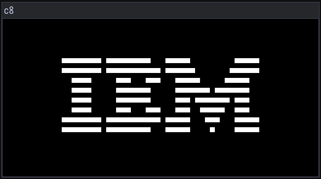

# c8
A chip8 emulator though it's more like a intrepreter.




## Prerequisites
- GCC 
- make
- SDL2

## Building
```bash
$ make
```

## Key Mapping
```txt
 1  2  3  4 
 Q  W  E  R 
 A  S  D  F 
 Z  X  C  V 

# ESC: Exit the emulator
```
